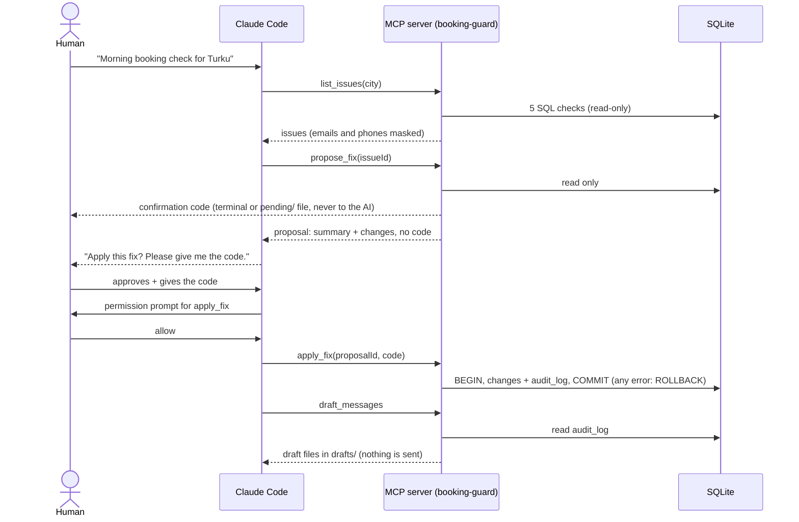

# Booking Guard

[](https://github.com/ko4an27/booking-guard/actions/workflows/ci.yml)

Booking systems collect messy data: the same customer booked twice, two customers in one time slot,
bookings for events that are cancelled or already over, broken contact details, events with more
bookings than places. Booking Guard is an AI agent, run from Claude Code, that finds these problems
in a bookings database (gold-valuation events in Finnish cities) and proposes fixes. **It never changes
data without a human's explicit approval**, and it writes the customer messages as drafts instead of sending them.

All data is fake and generated by `npm run seed`.

## How it works



## Quick start

Requires Node.js 22.

```bash
git clone https://github.com/ko4an27/booking-guard.git
cd booking-guard
npm ci
npm run seed    # creates data/booking-guard.db: 40 events, 331 customers, 513 bookings, 51 deliberate errors
npm run check   # prints the issues found (read-only, masked)
npm test        # runs the test suite
```

With Claude Code: open the project and approve the `booking-guard` MCP server from `.mcp.json`.
Then ask: *"Run the morning booking check for Turku."* The project skill
`.claude/skills/morning-booking-check` drives the routine. See [docs/demo.md](docs/demo.md) for a real run.

## The 5 checks

Each check is one SQL query (JOIN / GROUP BY) in `src/checks.ts` that returns a typed list of issues.

| # | Check | Finds | Proposed fix |
|---|---|---|---|
| 1 | Duplicate bookings | the same customer booked the same event more than once | keep the booking made first, archive the others |
| 2 | Double-booked slots | two different customers in the same event + time slot | move the later booking to the earliest free slot (customer gets a message) |
| 3 | Past or cancelled events | bookings for an event dated before today or cancelled | archive the booking (never delete) |
| 4 | Bad contact data | missing or malformed email or phone | none automatic: a human corrects it |
| 5 | Overbooked events | more bookings than the event's capacity | move the newest extra bookings to the next event in the same city with room, otherwise waitlist (customers get a message) |

Nothing is ever deleted: bookings are archived, moved or waitlisted.

## MCP tools

| Tool | What it does | Changes data? |
|---|---|---|
| `list_issues({ city? })` | runs the 5 checks | no |
| `propose_fix({ issueId })` | describes one fix and shows the confirmation code **to the human only** | no |
| `apply_fix({ proposalId, confirmationCode, dryRun })` | applies a stored proposal; dry run by default | **yes**, after a permission prompt |
| `draft_messages()` | writes one Finnish + English draft per affected customer to `drafts/` | files only; nothing is sent |

The server is `src/mcp-server.ts`, built on the official `@modelcontextprotocol/sdk` (stdio transport). Start it with `npm run mcp`.

## How it stays reliable

- **Tests (161, run in CI on every push and pull request).**
  - The seed inserts a known number of errors of each type (`tests/expected.json`). Every check must find exactly that number.
  - A clean database, hand-made near-misses and an empty database must give zero issues.
  - Key guarantees were also tested by breaking the code on purpose (removing the transaction, leaking the code, dropping the masking) to confirm the tests then fail.
- **Transactions and rollback.** `applyFix` runs every change and its audit row in one SQLite transaction.
  - Each `UPDATE` re-checks that the data still looks the way the proposal expected. If it doesn't, or anything else fails, the whole fix is rolled back.
  - Tests compare every table row by row before and after three kinds of failure halfway through a fix.
- **Audit log.** Every applied change writes an `audit_log` row: what changed, for which issue, and whether the customer needs a message. Message drafts are recorded too, so a second run never drafts the same change twice.
- **Masking.** Emails and phone numbers are masked (`a***@example.com`, `+358 *** ** 12`) in every tool result, in printed output and in the drafts.
  - A final pass masks anything that still looks like contact data.
  - Tests check every tool result against the real values in the database.
- **Confirmation code.** `apply_fix` needs a 6-character code that only the human was shown.
  - The code is an HMAC of that exact proposal, made with a secret held in the server's memory, so the AI can't compute it.
  - A changed fix needs a new code. Proposals are stored on the server, so the AI can't send back an edited one.
  - Each proposal is single-use, expires after 15 minutes and locks after 3 wrong codes.
- **Permission prompt.** `.claude/settings.json` sets `apply_fix` to `ask`, so Claude Code asks the human before every call, even if a user-level setting would allow it.

## Limitations

- **The permission prompt is the hard guarantee; the code is defense in depth.**
  - Without a terminal (e.g. Claude Code on the web) the code is written to `pending/CONFIRM-<id>.txt`. An AI with shell access could read that file.
  - The same AI could also change the database directly with `node` or `sqlite3`. Bash must stay on "ask" for this project.
  - `.claude/settings.json` also sets `disableBypassPermissionsMode`, but I have not verified that this works from project settings.
- **Demo scale.** SQLite, one user, about 500 fake bookings. There is no locking between two people fixing things at the same time: a stale proposal is refused and rolled back, but not merged.
- **Proposals live in the MCP server's memory.** A restart forgets open proposals.
- **Simple rules.** "Past" means the event date is before today in UTC. Seed dates are relative to the day you run the seed, so re-seed before a demo. Phone validation only knows Finnish `+358` numbers.
- **Fixes are opinionated.** An overbooked customer is moved to the next event in the same city, which may not suit them. There is no automatic promotion from the waitlist. Bad contact data always needs a human.
- **Drafts are templates.** They have a generic signature, no venue address (the schema only knows the city), and nothing sends them.

## Project structure

```
src/
  db.ts           schema (events, customers, bookings, audit_log, message_drafts)
  seed.ts         fake data with deliberate errors (seed-cli.ts = npm run seed)
  checks.ts       the 5 SQL checks (check-cli.ts + report.ts = npm run check)
  fixes.ts        proposeFix / applyFix
  messages.ts     message drafts
  mcp-server.ts   MCP server (npm run mcp)
  contacts.ts, mask.ts, random.ts
tests/            vitest, one file per module
.claude/          permission settings and the morning-booking-check skill
docs/demo.md      a real transcript of the morning check
```

## How it was built

I built this project with [Claude Code](https://claude.com/claude-code), in small steps: one feature per pull request,
each with tests. I reviewed every pull request before merging. Decisions about behaviour, such as "archive, never delete",
"move overbooked customers instead of cancelling them" and "the code never goes back to the AI", are recorded in `PROGRESS.md`.

## License

[MIT](LICENSE)
